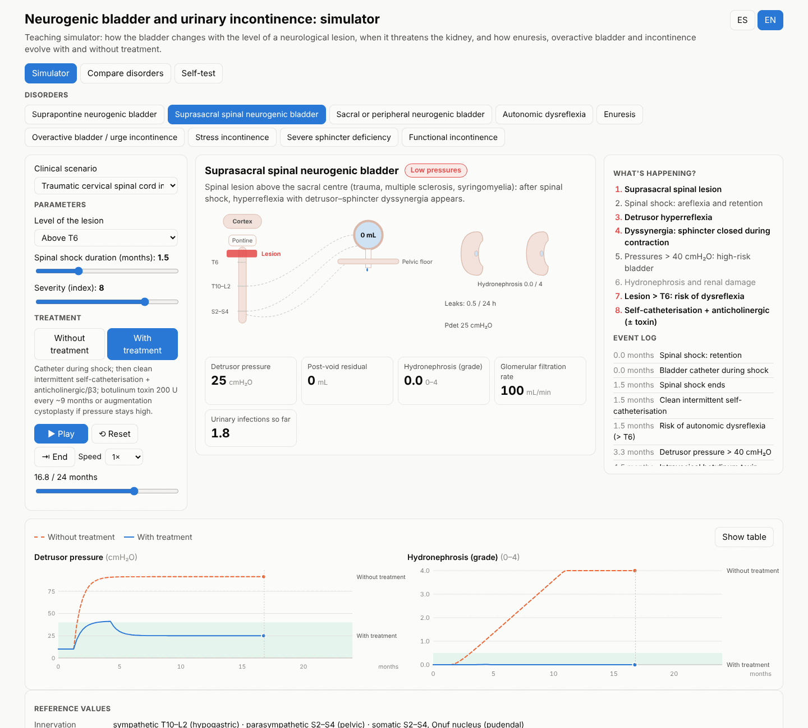

# Neurogenic bladder and urinary incontinence

**Vejiga neurógena e incontinencia urinaria** — interactive teaching simulator (Spanish / English).

**Live demo:** https://ferasmed-dev.github.io/neurogenic-bladder-incontinence/ · English: https://ferasmed-dev.github.io/neurogenic-bladder-incontinence/?lang=en



The neuraxis is drawn from cortex to sacral cord with the lesion marked; the bladder, sphincter, pelvic floor and both kidneys respond to it. Neurogenic disorders follow the level of the lesion, from spinal shock to high-pressure bladders that damage the kidneys. Non-neurogenic disorders follow their leak, urgency or wet-night counts. Every disorder is compared with and without treatment, with special panels for blood pressure in dysreflexia, the wet-night calendar in enuresis and the «DI MEARÉ» factors.

## What it shows

| Disorder | Time axis | Treatment arm |
|---|---|---|
| Suprapontine neurogenic bladder | months | anticholinergic / β3 |
| Suprasacral spinal neurogenic bladder (incl. spinal shock) | months | catheter in shock → self-catheterisation + anticholinergic/β3 → botulinum toxin 200 U every 9 months if Pdet stays high |
| Sacral / peripheral neurogenic bladder | months | clean intermittent self-catheterisation |
| Autonomic dysreflexia | hours | catheterise + IV antihypertensive at a chosen time |
| Enuresis | months | alarm, desmopressin (stopped at 6 months) or desmopressin with structured withdrawal |
| Overactive bladder / urge incontinence | months | mirabegron ± anticholinergic → tibial / sacral S3 neuromodulation or toxin 100 U if refractory |
| Stress incontinence (pure / mixed) | months | pelvic-floor training (kept up or abandoned) or mid-urethral sling |
| Severe sphincter deficiency | months | artificial urinary sphincter (activated ~6 weeks later) |
| Functional incontinence («DI MEARÉ») | weeks | correct the factor |

Every entity offers:

- a **schematic** that shows the mechanism live and highlights where the disorder acts;
- **sliders and choices** for the parameters that drive it;
- a **sin / con tratamiento** (without / with treatment) comparison drawn on the same chart (dashed = without, solid = with);
- a **"¿Qué está pasando?"** panel that lights up each step of the mechanism as it happens, plus an **event log**;
- gauges with reference ranges, a **data-table view** of every chart, a **compare** tab with all entities side by side and a **self-test** tab.

## Curriculum fit

For students and teachers at any Spanish medical faculty.

- **Module (Orden ECI/332/2008):** Módulo III, *Formación clínica humana* (with support from Módulo II for physiology and pathology).
- **Typical subjects:** Fisiopatología, Urología, Neurología, Pediatría (enuresis), Geriatría, Ginecología (stress incontinence).
- **MIR:** recurrent (level of lesion → bladder pattern, high-risk bladder, dysreflexia above T6, enuresis alarm, OAB ladder, sling).

## For teachers

Every scenario has a deep link you can project or share. Add `&lang=en` for English.

| Preset | Scenario (EN) | Expected result | Link |
|---|---|---|---|
| `ictus_urgencia` | Urgency after a stroke | Leaks 3.4/day, Pdet < 30, no hydronephrosis; drug from month 2 → 1.2/day | [ES](https://ferasmed-dev.github.io/neurogenic-bladder-incontinence/?preset=ictus_urgencia) · [EN](https://ferasmed-dev.github.io/neurogenic-bladder-incontinence/?preset=ictus_urgencia&lang=en) |
| `parkinson` | Parkinson disease | Leaks 2.3/day → 0.8/day with treatment | [ES](https://ferasmed-dev.github.io/neurogenic-bladder-incontinence/?preset=parkinson) · [EN](https://ferasmed-dev.github.io/neurogenic-bladder-incontinence/?preset=parkinson&lang=en) |
| `lesion_cervical` | Traumatic cervical spinal cord injury | Shock 1.5 months, then Pdet ~91, hydronephrosis 4, GFR 36 by month 24; treated: Pdet 25, GFR 100, toxin at month 4.5, dysreflexia risk flagged | [ES](https://ferasmed-dev.github.io/neurogenic-bladder-incontinence/?preset=lesion_cervical) · [EN](https://ferasmed-dev.github.io/neurogenic-bladder-incontinence/?preset=lesion_cervical&lang=en) |
| `esclerosis_multiple` | Multiple sclerosis | Pdet ~79 and GFR 38 untreated; treated kidneys protected, no dysreflexia (below T6) | [ES](https://ferasmed-dev.github.io/neurogenic-bladder-incontinence/?preset=esclerosis_multiple) · [EN](https://ferasmed-dev.github.io/neurogenic-bladder-incontinence/?preset=esclerosis_multiple&lang=en) |
| `mielomeningocele` | Myelomeningocele | Residual 550, low compliance (Pdet 60), hydronephrosis 4; self-catheterisation keeps both at bay | [ES](https://ferasmed-dev.github.io/neurogenic-bladder-incontinence/?preset=mielomeningocele) · [EN](https://ferasmed-dev.github.io/neurogenic-bladder-incontinence/?preset=mielomeningocele&lang=en) |
| `neuropatia_diabetica` | Diabetic neuropathy | Residual ~480 mL, ~11 infections in 2 years; self-catheterisation → residual 20 | [ES](https://ferasmed-dev.github.io/neurogenic-bladder-incontinence/?preset=neuropatia_diabetica) · [EN](https://ferasmed-dev.github.io/neurogenic-bladder-incontinence/?preset=neuropatia_diabetica&lang=en) |
| `disreflexia_globo` | Dysreflexia from a full bladder | Untreated SBP 245, HR 50; catheterised at 1 h → peak 165, resolved | [ES](https://ferasmed-dev.github.io/neurogenic-bladder-incontinence/?preset=disreflexia_globo) · [EN](https://ferasmed-dev.github.io/neurogenic-bladder-incontinence/?preset=disreflexia_globo&lang=en) |
| `disreflexia_tardia` | Dysreflexia treated late | Catheterised at 1.5 h → peak 215 before resolving | [ES](https://ferasmed-dev.github.io/neurogenic-bladder-incontinence/?preset=disreflexia_tardia) · [EN](https://ferasmed-dev.github.io/neurogenic-bladder-incontinence/?preset=disreflexia_tardia&lang=en) |
| `enuresis_alarma` | 7-year-old with an alarm | Wet nights 15 → 2.6/month at 1 year | [ES](https://ferasmed-dev.github.io/neurogenic-bladder-incontinence/?preset=enuresis_alarma) · [EN](https://ferasmed-dev.github.io/neurogenic-bladder-incontinence/?preset=enuresis_alarma&lang=en) |
| `enuresis_desmopresina` | 9-year-old on desmopressin | 15 → 4.3 in weeks, relapse to 11 after stopping at 6 months | [ES](https://ferasmed-dev.github.io/neurogenic-bladder-incontinence/?preset=enuresis_desmopresina) · [EN](https://ferasmed-dev.github.io/neurogenic-bladder-incontinence/?preset=enuresis_desmopresina&lang=en) |
| `enuresis_no_mono` | Non-monosymptomatic enuresis | 20 → 10/month with the alarm (poorer response) | [ES](https://ferasmed-dev.github.io/neurogenic-bladder-incontinence/?preset=enuresis_no_mono) · [EN](https://ferasmed-dev.github.io/neurogenic-bladder-incontinence/?preset=enuresis_no_mono&lang=en) |
| `vh_responde` | Overactive bladder that responds | Urgency 8 → 3/day, leaks 2 → 0.8/day | [ES](https://ferasmed-dev.github.io/neurogenic-bladder-incontinence/?preset=vh_responde) · [EN](https://ferasmed-dev.github.io/neurogenic-bladder-incontinence/?preset=vh_responde&lang=en) |
| `vh_refractaria_sacra` | Refractory overactive bladder | Little drug response; sacral S3 at month 3 → urgency 4/day | [ES](https://ferasmed-dev.github.io/neurogenic-bladder-incontinence/?preset=vh_refractaria_sacra) · [EN](https://ferasmed-dev.github.io/neurogenic-bladder-incontinence/?preset=vh_refractaria_sacra&lang=en) |
| `iue_malla` | Stress incontinence with a sling | Pad test 60 → 6 g/24 h, ICIQ 11 → 5 | [ES](https://ferasmed-dev.github.io/neurogenic-bladder-incontinence/?preset=iue_malla) · [EN](https://ferasmed-dev.github.io/neurogenic-bladder-incontinence/?preset=iue_malla&lang=en) |
| `iue_puerperio` | Postpartum stress incontinence | Pelvic-floor training kept up: 30 → 15 g/24 h | [ES](https://ferasmed-dev.github.io/neurogenic-bladder-incontinence/?preset=iue_puerperio) · [EN](https://ferasmed-dev.github.io/neurogenic-bladder-incontinence/?preset=iue_puerperio&lang=en) |
| `iu_mixta` | Mixed incontinence | Sling: 80 → 36 g/24 h (urge component remains) | [ES](https://ferasmed-dev.github.io/neurogenic-bladder-incontinence/?preset=iu_mixta) · [EN](https://ferasmed-dev.github.io/neurogenic-bladder-incontinence/?preset=iu_mixta&lang=en) |
| `esfinter_postprostatectomia` | Incontinence after radical prostatectomy | 500 g/24 h until activation at month 2.5 → 25 g/24 h | [ES](https://ferasmed-dev.github.io/neurogenic-bladder-incontinence/?preset=esfinter_postprostatectomia) · [EN](https://ferasmed-dev.github.io/neurogenic-bladder-incontinence/?preset=esfinter_postprostatectomia&lang=en) |
| `anciana_itu` | Older woman with a urinary infection | Leaks 3/day → resolved by week ~2.4 after treating the infection | [ES](https://ferasmed-dev.github.io/neurogenic-bladder-incontinence/?preset=anciana_itu) · [EN](https://ferasmed-dev.github.io/neurogenic-bladder-incontinence/?preset=anciana_itu&lang=en) |
| `anciano_fecaloma` | Older man with faecal impaction | Resolved by week ~4 after treating the impaction | [ES](https://ferasmed-dev.github.io/neurogenic-bladder-incontinence/?preset=anciano_fecaloma) · [EN](https://ferasmed-dev.github.io/neurogenic-bladder-incontinence/?preset=anciano_fecaloma&lang=en) |

You can also open a single entity with `?entity=<key>` (keys are listed in `src/model.js`).

## Model

- **Upper-tract risk:** hydronephrosis grade (0–4) grows at `0.35 · max(0, Pdet − 40)/40` per month and regresses below 35 cmH₂O; GFR falls 0.9 mL/min per month per grade; infections accumulate at a rate set by residual and catheter use (Model).
- **Spinal shock:** areflexia with retention (residual 600 mL, overflow leaks) for the chosen months; then Pdet rises towards `40 + 45·severity` with dyssynergia.
- **Dysreflexia:** bladder volume rises 300 mL/h from 0.1 h; above 400 mL with a lesion above T6, SBP approaches `115 + 100·drive` and HR falls (reflex bradycardia); catheterisation empties the bladder within minutes.
- **Enuresis:** spontaneous resolution 15 %/year; alarm takes wet nights to 20 % of baseline (τ 1.5 months); desmopressin to 30 % in days, relapsing to 90 % when stopped (55 % with structured withdrawal); non-monosymptomatic halves the response.
- **Stress incontinence:** sling leaves 10 % of the leakage (45 % if mixed); pelvic-floor training 50 % while kept up.

**Model** tag: constants marked "Model" in `src/model.js` are teaching assumptions tuned so each preset reproduces the textbook course; they are not fitted to patient data.

### Parameters

| Parameter | Range (default) | Basis |
|---|---|---|
| Severity | 1–10 (6–7) | Model |
| Spinal shock | 0.5–4 months (1.5) | days to months |
| Lesion level | above / below T6 | dysreflexia above T6 |
| High-risk bladder | Pdet > 40 cmH₂O | standard |
| Wet nights | 4–30 per month (15) | enuresis ≥ 1/month at ≥ 5 years |
| Leakage (pad test) | 10–200 g/24 h (60); sphincter 200–800 (500) | Model |
| Toxin dose | 100 U non-neurogenic / 200 U neurogenic | standard |
| Sling cure | 90 % of leakage removed | 70–95 % cure |

### Known simplifications

- Lesion level is a category, not a segment-by-segment model; incomplete lesions are not modelled.
- Symptom counts are smooth averages; daily variability is not shown.
- ICIQ-SF is approximated from leaks and pad weight (Model).

### Content beyond the core notes

- Innervation is written as sympathetic **T10–L2** (hypogastric), parasympathetic S2–S4 (pelvic, contracts the detrusor) and somatic S2–S4 / Onuf (pudendal); some notes say the parasympathetic "relaxes" the detrusor (it is the sympathetic) and give T10–T12.
- First-line drugs for overactive bladder: mirabegron and antimuscarinics are both first-line in current guidelines (EAU / AUA).
- The 40 cmH₂O high-risk threshold (McGuire) and toxin doses follow standard references.

## Layout

```
index.html
src/model.js       pure model: entities, gauges, presets, simulate()
src/i18n.js        ES + EN strings (events are factories, so a language switch re-renders them)
src/ui.js          DOM, animation loop, explanations; exposes window.__sim for automated checks
src/schematic.js   SVG schematic of the mechanism, redrawn every frame
src/charts.js      dependency-free SVG line charts with hover tooltips and table view
src/styles.css     light/dark via prefers-color-scheme, responsive
tests/model.test.js
curriculum.json    topic metadata
```

## Run locally

```bash
python3 -m http.server 8000
# open http://localhost:8000/
```

No build step, no dependencies.

## Tests

```bash
npm test        # node --test (Node 18+)
```

The tests cover well-formed output for every entity at default and extreme parameters (finite, non-negative, valid steps), purity, i18n completeness in both languages, every preset, and the key mechanism of each entity (direction of each effect and the treatment comparison). GitHub Actions runs them on every push.

## Deploy (GitHub Pages)

Settings → Pages → *Deploy from a branch* → `main` / `(root)`. The site is served at https://ferasmed-dev.github.io/neurogenic-bladder-incontinence/.

## References

- Groen J, et al. Summary of European Association of Urology Guidelines on Neuro-Urology. *Eur Urol* 2016;69:324–33.
- McGuire EJ, et al. Prognostic value of urodynamic testing in myelodysplastic patients. *J Urol* 1981;126:205–9.
- Nevéus T, et al. Management and treatment of nocturnal enuresis: an updated standardisation document from the ICCS. *J Pediatr Urol* 2020;16:10–19.
- Nambiar AK, et al. EAU Guidelines on assessment and nonsurgical management of urinary incontinence. *Eur Urol* 2018;73:596–609.
- Krassioukov A, et al. Autonomic dysreflexia in spinal cord injury. *Arch Phys Med Rehabil* 2009;90:682–95.

---

Herramienta docente · no apta para uso clínico — Teaching tool · not for clinical use. MIT licence © 2026 Feras Elhissi.
